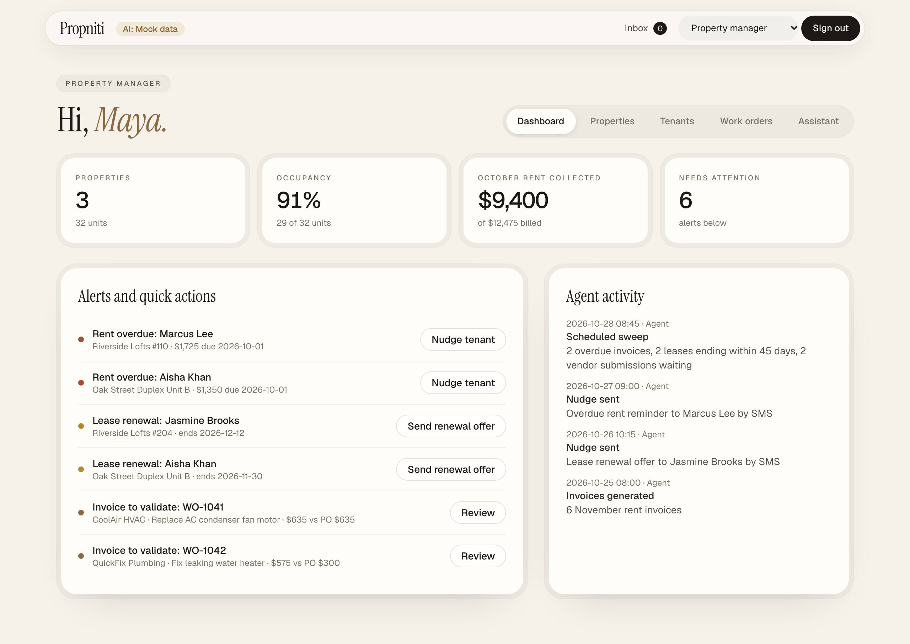

# Propniti

**AI property operations for US multifamily and commercial portfolios.**
Agents chase rent, check every vendor invoice against its purchase order and keep each lease on track. A person approves anything that moves money.

Live demo: **[propniti.ai](https://propniti.ai)** · runs on sample data, no sign-up needed.



## What it does

| Use case | In the app |
| --- | --- |
| AI-native onboarding | New managers import their portfolio from an AppFolio, Buildium, Yardi or spreadsheet rent-roll export (CSV/TSV): AI matches the columns, every row is checked (missing fields, bad rent or dates, duplicates) before import. Or paste free text and AI turns it into rows. Then connect a bank (simulated) and invite owners and vendors. Samples in `public/samples/` |
| Run more properties per manager | One dashboard: portfolio stats, alerts with one-click actions, live agent activity |
| Vendor work-order automation | The agent compares invoice line items, totals and job photos with the PO; the manager approves or sends it back; the vendor sees the payout and 1099 status |
| Track critical events | Overdue rent and lease renewals become alerts; nudges go out on each person's preferred channel |
| Keep the agent honest | Every result has a confidence score and evidence; a rule-based policy check stops the model approving what the rules flag; every payment needs a human |
| Read invoices with AI | Upload a photo or PDF of an invoice; a vision model extracts vendor, line items and total, checks it adds up, and fills the submission. Sample invoices are in `public/samples/` |
| Money through a trust account | Tenant rent clears into the manager's trust account, the 8% management fee is taken automatically, vendor payouts leave on approval, and owners are paid from a statement (rent − fee − vendor bills). Every transfer has an idempotency key and moves Pending → Cleared (simulated ACH, seconds instead of days) |
| Ratings and feedback | Tenants rate completed jobs, their manager and their building; managers rate vendors and maintenance staff. Averages show on profiles; 1–2 star ratings raise an alert |
| Ask your portfolio | "Who is late on rent?" — answers from your data plus suggested next actions |
| A view per role | Property manager, owner, tenant, maintenance, vendor and admin |

Each visitor gets a private copy of the demo, stored on the server (Cloudflare D1, or SQLite in Docker) and found by an HttpOnly cookie. It is deleted at midnight Pacific time (`DEMO_RESET_TZ` in `src/lib/seed.ts`). Use the **Demo** control at the bottom of the app to switch roles; Admin → *Reset demo data* starts over.

## Quick start

Requires Node.js 24.

```bash
npm install
npm run dev          # http://localhost:3000
```

| Command | What it does |
| --- | --- |
| `npm run dev` | Next.js dev server |
| `npm test` | Unit tests (Vitest) |
| `npm run test:coverage` | Unit tests with a coverage report (`coverage/index.html`) |
| `npm run lint` | ESLint |
| `npm run build` | Next.js production build |
| `npm run dev:vinext` | Dev server on the Cloudflare Workers runtime (run `npm run db:migrate:local` once first) |
| `npm run db:migrate:local` | Apply `migrations/` to the local D1 database used by `dev:vinext` |
| `npm run build:vinext` | Cloudflare Workers build |
| `npm run deploy:vinext` | Deploy to Cloudflare Workers |

## Tests and coverage

87 tests in 11 files run on every push in CI. They cover the money, invoice-checking, import, ratings, request-validation and rate-limit rules, the AI provider choice, and the server storage. The storage tests run the real migrations on SQLite, plus one test on a local D1 database (Miniflare). They include rent with the 8% fee, vendor approval, owner payout, refusal when trust is short, and two identical requests at once (a double-click) creating one payment.

Coverage of the business logic and API routes (`npm run test:coverage`):

| Area | Lines | Branches |
| --- | --- | --- |
| Ledger and payments (`ledger.ts`, `server/money.ts`) | 100% | 89% |
| Rent-roll import (`importer.ts`) | 100% | 94% |
| Ratings (`ratings.ts`) | 100% | 100% |
| Request schemas (`requests.ts`) | 100% | 86% |
| Workspaces and midnight reset (`server/workspace.ts`) | 100% | 89% |
| Database reads and writes (`server/repo.ts`, `platform/sqlite.ts`) | 98% | 91% |
| Rate limits and body caps (`guard.ts`) | 97% | 84% |
| Invoice rules and assistant facts (`mockAi.ts`) | 86% | 79% |
| Store actions on the server (`server/actions.ts`) | 72% | 52% |
| AI provider calls (`llm.ts`) | 72% | 61% |
| AI routes (`app/api/ai/*`) | 59% | 39% |
| **All logic and API code** | **81%** | **75%** |

Not covered by unit tests:
- The React screens and the browser store (`store.tsx`). These were checked end to end in a browser with Playwright before each deploy; those scripts are not in this repo yet.
- Some thin route files (for example reset, ratings and onboarding). Their logic in `server/actions.ts` is partly tested.
- The `import-map`, `import-parse` and `status` AI routes, and the live calls to Anthropic, OpenAI and Workers AI (tests use mocks).

## AI providers

AI features run on **built-in mock results by default** — no key required. To use a real model, copy `.env.example` to `.env.local` and set one of:

| Variable | Purpose |
| --- | --- |
| `ANTHROPIC_API_KEY` | Use Claude (default model `claude-opus-5`, override with `ANTHROPIC_MODEL`) |
| `OPENAI_API_KEY` | Use OpenAI (default model `gpt-5.5`, override with `OPENAI_MODEL`) |
| `AI_PROVIDER` | Force `anthropic`, `openai`, `workers-ai` or `mock`. Authoritative: if the forced provider isn't configured, mock is used — data is never sent to a different provider |
| `TRUSTED_IP_HEADER` | Off Cloudflare only: the client-IP header your proxy sets (e.g. `x-forwarded-for`), used for per-client rate limits. Unset = one shared budget |

On Cloudflare, **Workers AI** (`@cf/meta/llama-4-scout-17b-16e-instruct`, a vision model) is used automatically when no API key is set — no key or extra setup needed. It reads uploaded invoices, validates them against purchase orders and answers assistant questions.

If a key is set but the call fails (bad key, timeout, refusal), the app falls back to the mock result and says so next to it. The rule-based checks in [`src/lib/mockAi.ts`](src/lib/mockAi.ts) double as the policy check on real model output ([`src/lib/llm.ts`](src/lib/llm.ts)).

## Deploy

The app runs on any host; nothing in the application code depends on one cloud.

**Cloudflare Workers** (how propniti.ai is hosted), built with [vinext](https://github.com/cloudflare/vinext):

```bash
npx cf auth login
npx cf d1 create --name propniti                 # once; put the id in cloudflare.config.ts (DB binding)
npx cf d1 migrations apply <database-id>         # schema from migrations/
npm run deploy:vinext
npx wrangler secret put ANTHROPIC_API_KEY   # optional
```

Edit `cloudflare.config.ts` to change the Worker name or custom domains. On the first deploy, pass placeholder secrets (`ANTHROPIC_API_KEY=unset`, etc.) with `npx cf deploy --secrets-file <file>`; the app treats `unset` as "no key".

**Docker** (AWS, GCP, Azure, Fly, Render, Kubernetes…):

```bash
docker build -t propniti .
docker run -p 3000:3000 -v propniti-data:/data -e ANTHROPIC_API_KEY=... propniti
```

Demo data is a SQLite file at `DATABASE_PATH` (default `/data/propniti.db`), created and migrated on first start. Expired demo workspaces are cleaned up as new ones are created.

## Project layout

```
src/
  app/                 routes: marketing (/), auth (/login, /signup, /forgot-password),
                       demo picker (/demo), one route per role, /api/ai/*,
                       demo data routes (/api/state, /api/work-orders/*, …)
  components/
    marketing/         landing page and auth building blocks
    views/             screens for each role
    Shell.tsx          in-app chrome; DemoSwitcher.tsx is the demo-only role switcher
    ui.tsx             cards, badges, buttons, tables, AI result card
  lib/
    llm.ts             provider selection, real model calls, mock fallback, policy check
    mockAi.ts          rule-based invoice validation and assistant answers
    ledger.ts          trust-account transfers, settlement, owner statements, payouts
    ratings.ts         rating summaries, one-per-job rule, low-rating alerts
    importer.ts        rent-roll import: CSV parsing, column matching, row checks, merge
    requests.ts        input validation for the public API routes
    guard.ts           per-IP rate limiting
    platform/          host-specific services: D1 or SQLite, Workers AI, rate limiters
    store.tsx          demo state in the browser; every action calls the API
  server/
    workspace.ts       per-visitor workspace: cookie, midnight expiry, reset
    money.ts           rent, vendor payouts, owner payouts and settlement as guarded SQL batches
    actions.ts         the other demo actions
    repo.ts            rows ↔ demo state
migrations/            D1 / SQLite schema
    seed.ts            sample portfolio
```

## Docs

`/docs` publishes snapshots of the product specification, solution architecture and prototype walkthrough (Claude Docs). They are unlisted: every docs page sends `robots: noindex, nofollow`. The text lives in `content/docs/*.md` and the images in `public/docs/<slug>/`; pages render the markdown with `marked` at build or request time, with no call to claude.ai.

To refresh a snapshot: read each doc's body node in full with the Claude Docs tools and save the XML, download its images (each `blob` maps to an artifact asset), render any diagram widgets to SVG, then run `node scripts/docs-import.mjs <manifest.json>` (the manifest format is at the top of the script). Update `SNAPSHOT_DATE` in `src/lib/docs.ts` and run `npm test`, which checks every anchor, doc link and image.

## Limits of this demo

- Sign-in and sign-up are screens only: no accounts are created and nothing is sent.
- Payments are a simulated ledger (no money moves); SMS, WhatsApp, email and voice are simulated and land in each persona's in-app inbox.
- Demo workspaces are anonymous and short-lived: anyone holding the cookie can act as any persona in that workspace.
- The AI routes are validated, size-capped and rate limited per IP; see [docs/security-review.md](docs/security-review.md) for the full review and known gaps.

## Security

See [SECURITY.md](SECURITY.md) to report a vulnerability and [docs/security-review.md](docs/security-review.md) for the current review.

## Contributing

Issues and pull requests are welcome. Please run `npm run lint && npm test` before opening a PR.

## License

[GNU Affero General Public License v3.0](LICENSE). You can use, modify and self-host Propniti; if you run a modified version as a network service, you must publish your changes under the same license.
