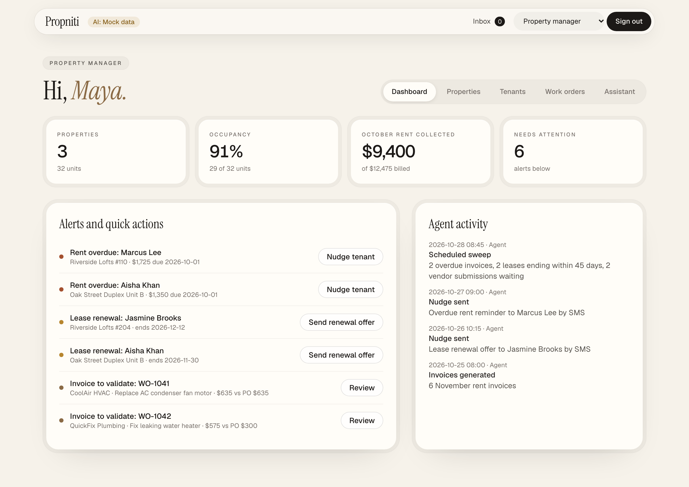

# Propniti

**Property management software for US residential and commercial portfolios.**
Eight AI agents find routine work and propose what to do. A person approves anything that involves money, legal terms or safety.

Live demo: **[propniti.ai](https://propniti.ai)** · runs on sample data, no sign-up needed.



This README describes v2 (branch `v2-saas`). Product goals and principles are in [PRODUCT.md](PRODUCT.md); code conventions are in [AGENTS.md](AGENTS.md).

## What it does

- **One record framework.** 64 record types in 13 modules are each described once (`src/entities/defs/`). The framework builds their list and record pages, the API, CSV export, permission checks and search from those definitions.
- **A sample portfolio.** 30 properties in Austin, Dallas, Atlanta and Phoenix, with leases, ledgers, work orders, bills and history. Some records are wrong on purpose, so Data Health has issues to find.
- **A simulated trust ledger.** Rent, fees, vendor bills, owner distributions and deposits move through guarded SQL. Every transfer has an idempotency key, so a double click pays once. No real money moves.
- **AI agents with an audit trail.** Agents run every 15 minutes, on events and on request. Each run and step is stored and viewable. Agents propose; people approve.
- **Data Health.** Rules find bad records (duplicates, miscoded bills, rent typos, unverified vendor bank changes). Each fix shows before and after and is logged.

## Personas

Sign in on `/login` with a demo account (`<persona id>@propniti.demo`, for example `marcus@propniti.demo`; every account uses the password `propniti-demo`), or click a person's card to fill the form. `/login?as=<id>` prefills a person and `next` deep links are kept. Each persona sees only its own scope.

| Persona | Role | Scope | Lands on |
| --- | --- | --- | --- |
| Daniel Reyes | Principal | All 30 properties | `/app` |
| Priya Shah | Regional manager | Texas | `/app` |
| Marcus Bell | Property manager | 3 Austin properties | `/app/today` |
| Lena Ortiz | Leasing agent | 3 Austin properties | `/app/leasing/today` |
| Rachel Moore | Broker | All properties | `/app/leasing/broker` |
| Grace Kim | Accountant | All owner entities | `/app/finance` |
| Tom Alvarez | Maintenance supervisor | Texas | `/app/maintenance` |
| Sam Okafor | Admin | Org settings | `/app/admin` |
| Nadia Brooks | Platform admin | All customer orgs | `/app/admin` |
| Helen Carter | Owner (portal) | Own entities | `/portal/owner` |
| Jordan Lee | Resident (portal) | Own lease | `/portal/resident` |
| Luis Ramirez | Vendor (portal) | Own jobs | `/portal/vendor` |
| Priyanka Rao | Applicant (portal) | Own application | `/portal/applicant` |

The public listings site (`/listings`) needs no persona.

## Modules

Portfolio, leasing, residents, maintenance, receivables, payables, accounting (banking, GL, budgets, reports), owners and statements, communications, risk and compliance, settings, platform, and intelligence (agents, approvals, AI activity, Data Health, copilot). Definitions live in `src/entities/defs/<module>.ts`; custom actions, tabs, widgets and metrics live in `src/extensions/<module>/`.

## Quick start

Requires Node.js 24.

```bash
npm ci
npm run dev          # http://localhost:3000
```

On first start, `npm run dev` creates a SQLite file at `.data/propniti.db`, applies `migrations/` and generates the sample data. No AI key is needed: without one, agents and the assistant use rules and say so.

| Command | What it does |
| --- | --- |
| `npm run dev` | Next.js dev server (Node, SQLite) |
| `npm run dev:vinext` | Dev server on the Cloudflare Workers runtime, with a local D1 database |
| `npm run db:migrate:local` | Apply `migrations/` to the local D1 database that `dev:vinext` uses |
| `npm test` | Unit and integration tests (Vitest) |
| `npm run test:coverage` | Tests with a coverage report |
| `npm run lint` | ESLint |
| `npm run typecheck` | Generate route types, then type check |
| `npm run check` | Lint, type check and tests; run before every pull request |
| `npm run build` | Next.js production build |
| `npm run build:vinext` | Cloudflare Workers build |
| `npm run deploy:vinext` | Deploy to Cloudflare Workers |
| `npm run eval` | Live AI eval (see below) |

### Loading the sample data into D1

The sample data ("base") is loaded once per database, at deploy time, never per request. Loading it wipes every visitor's changes.

```bash
node scripts/seed-d1.mjs                                     # writes .seed/base.sql
npx cf d1 migrations apply <database-id>                     # schema
npx wrangler d1 execute <DB> --remote --file .seed/base.sql --yes
npx wrangler d1 execute <DB> --remote --file .seed/ai-precompute.sql --yes   # only if the file exists
```

For the local D1 that `dev:vinext` uses, run `npm run db:migrate:local`, then the same `execute` commands with `--local --persist-to .cloudflare/state` in place of `--remote`.

`scripts/ai-precompute.mjs` writes `.seed/ai-precompute.sql`: record summaries written ahead of time by a model, so first views need no live call. Instructions are at the top of the script.

## How the data works

- Base rows have `workspace_id = 'base'` and are read-only at runtime. A visitor's changes are rows under their own workspace id, found by the HttpOnly cookie `pn_ws`. Reads take the visitor's rows plus every base row they haven't replaced (`src/server/effective.ts`).
- The visitor's changes are wiped at midnight Pacific time.
- Money is stored in integer cents. Each money action is one guarded SQL batch (`src/server/money.ts`).
- Migrations `0001`–`0006` are in `migrations/`, shared by D1 and SQLite.

## AI

The orchestrator and agents live in `src/ai`.

- **Triggers.** A Cron Trigger every 15 minutes (`src/worker-entry.ts`), a sweep on page visits when the cron hasn't run, events from the `events` outbox, "Run now" on `/app/agents`, and assistant chat.
- **Agents.** Collections, Leasing, Renewals, Maintenance triage, Payables, Data Health, Owner Reporting and Compliance. Rules find the candidates and compute every figure. A model, when configured, picks and words the proposals and may only choose from the candidates.
- **Approvals.** Low-risk proposals from agents set to "auto within policy" apply at once. Everything else waits in `/app/ai/approvals`; spend above an owner's threshold waits for the owner. Before an approved proposal runs, the server checks scope, the record's key fields and the action's precondition again.
- **Traces.** Every run and step is stored in `agent_runs` and `agent_steps`. Open a run at `/app/ai/runs/<id>`.
- **Labels.** Each AI output says whether it came from a live model, was precomputed, or came from rules.

### Providers

| Variable | Effect |
| --- | --- |
| `ANTHROPIC_API_KEY` | Use Claude (default `claude-opus-5`; override with `ANTHROPIC_MODEL`) |
| `OPENAI_API_KEY` | Use OpenAI (default `gpt-5.5`; override with `OPENAI_MODEL`), when no Anthropic key is set |
| `AI_PROVIDER` | Force `anthropic`, `openai` or `workers-ai`. If the forced provider isn't configured, rules answer; data is never sent to another provider |
| `TRUSTED_IP_HEADER` | Off Cloudflare only: the client-IP header your proxy sets, used for per-client rate limits |

On Cloudflare with no key, Workers AI (`@cf/meta/llama-4-scout-17b-16e-instruct`) is the model. It uses a JSON plan loop with one tool call per turn; Claude and OpenAI use native tool calling. If a call fails, the rules answer and the label says so.

## Tests, evals and coverage

Measured on 2026-11-04 at commit `a5fc28d`.

- **Vitest:** 951 tests in 100 files, all passing. They cover money, scope, the query layer, migrations on SQLite and on local D1 (Miniflare), the seed generator, module actions, agents and the assistant. Money actions have double-click tests that must move money once.
- **Playwright:** 93 browser tests in 22 flows in `tests/e2e/`, one per module plus portals and public listings. They expect a dev server at `BASE_URL` (default `http://localhost:3201`) and have no config file yet: `npx playwright test tests/e2e/<flow>.spec.ts`.
- **Coverage** (`npm run test:coverage`, scope `src/lib`, `src/server`, `src/app/api`): 70% of lines and 61% of branches. `src/ai` and `src/extensions` are outside that scope.

| Area | Lines | Branches |
| --- | --- | --- |
| Money actions (`server/money.ts`) | 98% | 76% |
| Workspaces (`server/workspace.ts`) | 100% | 90% |
| Query layer (`server/query.ts`) | 88% | 79% |
| Scope and permissions (`server/permissions.ts`) | 93% | 79% |
| Base and overlay reads (`server/effective.ts`) | 93% | 88% |
| Base load (`server/base.ts`) | 94% | 83% |
| Rate limits and body caps (`lib/guard.ts`) | 97% | 88% |
| Model calls (`lib/llm.ts`) | 82% | 64% |
| API routes (`app/api`) | 32% | 26% |

The v1 server code (`server/repo.ts`, `route.ts`, `actions.ts`, `legacy-money.ts`) is still in the coverage scope and mostly untested, which lowers the totals.

### AI evals

`evals/cases/` holds 15 files with 126 cases. Every grader is a fixed rule; no model grades another.

- `npm run eval` sends 83 cases in 10 areas to a running app (`BASE_URL`, default `https://propniti.ai`) and writes [`evals/results/latest.md`](evals/results/latest.md). It exits 1 below `MIN_PASS` (default 0.8). It is not part of CI; there is a manual **AI eval** workflow.
- 43 more cases (triage, drafts, data fixes, applicant scoring, resident replies) run inside `npm test`, graded on the rules output with no model.

**Latest live run:** 2026-11-03 21:11 UTC, Workers AI on a local server, **59/75 (79%)**, under the 0.8 bar. Invoice reading, invoice vs PO, column mapping and pasted notes passed every case. Agent runs passed 1 of 8; 6 fell back to rules. Fixes landed after this run and it has not been repeated. The report builder's 8 cases joined the live suite after it and have no live score yet.

## Deploy

```bash
npx cf auth login
npx cf d1 migrations apply <database-id>
# load the base (see "Loading the sample data into D1")
npm run deploy:vinext
npx wrangler secret put ANTHROPIC_API_KEY   # optional
```

`cloudflare.config.ts` sets the Worker name, domains, the D1 binding, the Workers AI binding, two rate limiters (20 AI calls and 60 writes a minute per IP), the `src/worker-entry.ts` entry and the 15-minute Cron Trigger. The v2 preview runs as a separate Worker with its own D1 database; deploy it by changing the name, domains and database id before `deploy:vinext`. Run remote migrations before deploying.

**Docker** (any container host):

```bash
docker build -t propniti .
docker run -p 3000:3000 -v propniti-data:/data propniti
```

Data is a SQLite file at `DATABASE_PATH` (default `/data/propniti.db`), migrated and seeded on first start. There is no Cron Trigger off Cloudflare, so agents run from page visits, at most once every 15 minutes.

## Limits of this demo

- Personas are demo accounts with one published password (`propniti-demo`), or a one-click card. There are no real accounts or stored passwords, and anyone can act as any persona.
- Payments are simulated in SQL; transfers settle 8 seconds after they start. SMS, email and voice are not sent.
- The v1 API routes (`/api/state`, `/api/work-orders/*` and others) are still mounted but read tables the v2 schema drops.
- See [docs/security-review.md](docs/security-review.md) for the controls and known gaps.

## Security

See [SECURITY.md](SECURITY.md) to report a vulnerability and [docs/security-review.md](docs/security-review.md) for the current review.

## Contributing

Issues and pull requests are welcome. See [CONTRIBUTING.md](CONTRIBUTING.md); run `npm run check` before opening a pull request. Code conventions are in [AGENTS.md](AGENTS.md).

## License

[GNU Affero General Public License v3.0](LICENSE). You can use, modify and self-host Propniti; if you run a modified version as a network service, you must publish your changes under the same license.
