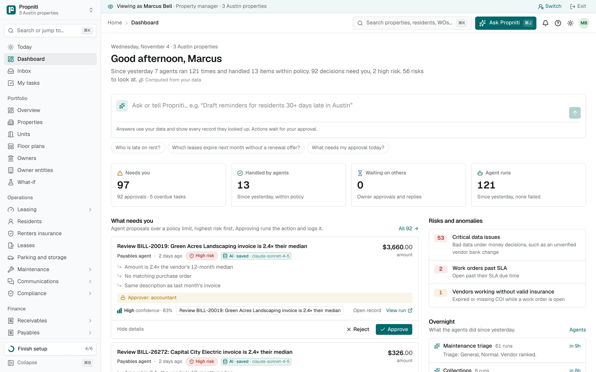
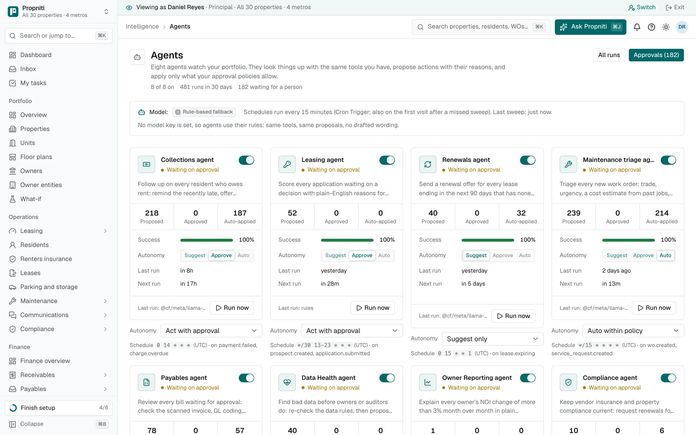
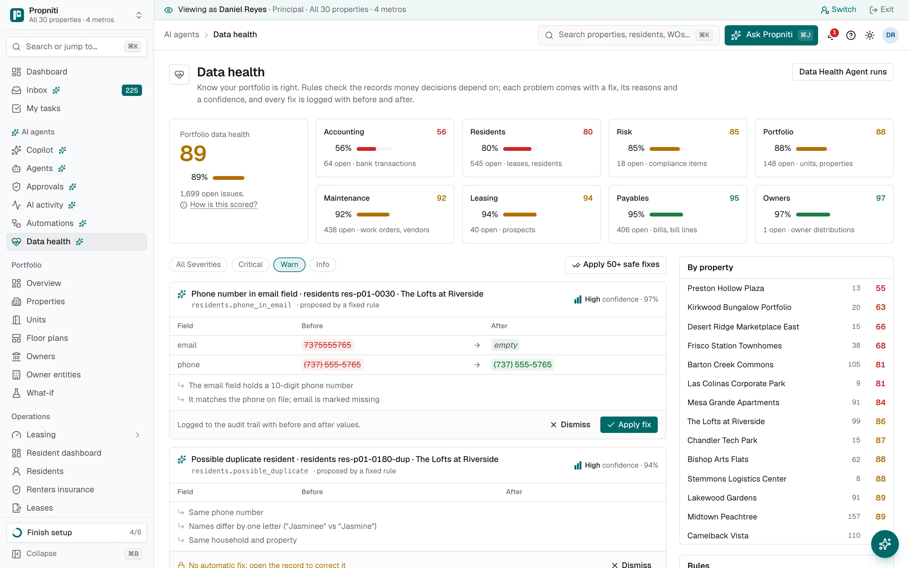
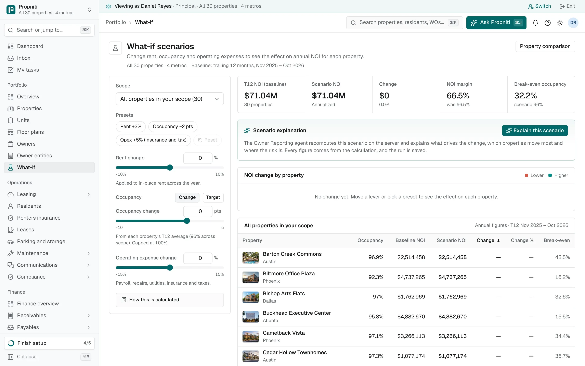

# Propniti

**Property management software for US residential and commercial portfolios.**
Eight AI agents find routine work and propose what to do. A person approves anything involving money, legal terms or safety.

Live demo: **[propniti.ai](https://propniti.ai)** · sample data, no sign-up. Product docs: **[propniti.ai/docs](https://propniti.ai/docs)**.



| AI agents | Data Health | What-if |
| --- | --- | --- |
|  |  |  |

[PRODUCT.md](PRODUCT.md) has the product goals and principles; [AGENTS.md](AGENTS.md) has the code conventions.

## What it does

- **One record framework.** 64 record types in 13 modules, each defined once. Pages, the API, permission checks, search and downloads are built from the definitions.
- **A sample portfolio.** 30 properties in Austin, Dallas, Atlanta and Phoenix, with leases, ledgers, work orders, bills and history. Some records are wrong on purpose, for Data Health to find.
- **A simulated trust ledger.** Rent, fees, bills, owner distributions and deposits move through guarded SQL; a double click pays once.
- **AI agents with an audit trail.** Agents run every 15 minutes, on events and on request, and each step is stored. Agents propose; people approve.
- **Data Health.** Rules find bad records (duplicates, miscoded bills, rent typos, unverified vendor bank changes) and suggest fixes with before and after values.

## Personas

Sign in at `/login` with `<persona id>@propniti.demo` (for example `marcus@propniti.demo`) and the password `propniti-demo`, or click a person's card. `/login?as=<id>` prefills a person.

| Persona | Role | Scope | Lands on |
| --- | --- | --- | --- |
| Daniel Reyes | Principal | All 30 properties | `/app` |
| Priya Shah | Regional manager | Texas | `/app` |
| Marcus Bell | Property manager | 3 Austin properties | `/app/today` |
| Lena Ortiz | Leasing agent | 3 Austin properties | `/app/leasing/today` |
| Rachel Moore | Broker | All properties | `/app/leasing/broker` |
| Grace Kim | Accountant | All owner entities | `/app/finance` |
| Tom Alvarez | Maintenance supervisor | Texas | `/app/maintenance` |
| Sam Okafor | Admin | Org settings | `/app/admin` |
| Nadia Brooks | Platform admin | All customer orgs | `/app/admin` |
| Helen Carter | Owner (portal) | Own entities | `/portal/owner` |
| Jordan Lee | Resident (portal) | Own lease | `/portal/resident` |
| Luis Ramirez | Vendor (portal) | Own jobs | `/portal/vendor` |
| Priyanka Rao | Applicant (portal) | Own application | `/portal/applicant` |

The public listings site (`/listings`) needs no sign-in.

## Quick start

Requires Node.js 24.

```bash
npm ci
npm run dev          # http://localhost:3000
```

The first start creates `.data/propniti.db`, applies `migrations/` and generates the sample data. No AI key is needed; without one, AI features use rules and say so.

| Command | What it does |
| --- | --- |
| `npm run dev` | Next.js dev server (Node, SQLite) |
| `npm run dev:vinext` | Dev server on the Cloudflare Workers runtime, with a local D1 database |
| `npm run db:migrate:local` | Apply `migrations/` to the local D1 database that `dev:vinext` uses |
| `npm test` | Unit and integration tests (Vitest) |
| `npm run test:coverage` | Tests with a coverage report |
| `npm run lint` | ESLint |
| `npm run typecheck` | Generate route types, then type check |
| `npm run check` | Lint, type check and tests; run before every pull request |
| `npm run build` | Next.js production build |
| `npm run build:vinext` | Cloudflare Workers build |
| `npm run deploy:vinext` | Deploy to Cloudflare Workers |
| `npm run eval` | Live AI eval (see below) |

### AI providers

| Variable | Effect |
| --- | --- |
| `ANTHROPIC_API_KEY` | Use Claude (default `claude-opus-5`; override with `ANTHROPIC_MODEL`) |
| `OPENAI_API_KEY` | Use OpenAI (default `gpt-5.5`; override with `OPENAI_MODEL`), when no Anthropic key is set |
| `AI_PROVIDER` | Force `anthropic`, `openai` or `workers-ai`. If the forced provider isn't configured, rules answer |
| `TRUSTED_IP_HEADER` | Off Cloudflare only: the client-IP header your proxy sets, for per-client rate limits |

On Cloudflare with no key, the model is Workers AI (`@cf/meta/llama-4-scout-17b-16e-instruct`). A failed call falls back to rules, and the label says so.

### Loading the sample data into D1

Load the base once per database, at deploy time. It wipes every visitor's changes.

```bash
node scripts/seed-d1.mjs                                     # writes .seed/base.sql
npx cf d1 migrations apply <database-id>                     # schema
npx wrangler d1 execute <DB> --remote --file .seed/base.sql --yes
npx wrangler d1 execute <DB> --remote --file .seed/ai-precompute.sql --yes   # only if the file exists
```

For the local D1 that `dev:vinext` uses, run `npm run db:migrate:local`, then the same `execute` commands with `--local --persist-to .cloudflare/state` in place of `--remote`. `scripts/ai-precompute.mjs` writes `.seed/ai-precompute.sql` (model-written record summaries); instructions are at the top of the script.

## Where things are

| Path | What's there |
| --- | --- |
| `src/entities/defs/<module>.ts` | Record type definitions |
| `src/extensions/<module>/` | Custom actions, tabs, widgets and metrics |
| `src/server/` | Storage and money: `money.ts` (guarded SQL batches), `effective.ts` (base plus overlay reads) |
| `src/ai/` | Orchestrator, agents, tools, assistant |
| `src/worker-entry.ts` | Worker entry and the 15-minute Cron Trigger |
| `migrations/` | SQL migrations `0001`–`0008`, shared by D1 and SQLite |
| `evals/` | Live AI eval cases and results |
| `content/docs/` | Product docs served at `/docs` |

Base rows have `workspace_id = 'base'` and are read-only. A visitor's changes live under their own workspace id (HttpOnly cookie `pn_ws`) and are wiped at midnight Pacific. Money is stored in integer cents.

## Docs

The spec, architecture and walkthrough are at [propniti.ai/docs](https://propniti.ai/docs). Their Markdown is in `content/docs/` and their images in `public/docs/<slug>/`; `scripts/docs-import.mjs` imports them from Claude Docs (usage at the top of the script).

## Tests, evals and coverage

Measured on 2026-11-04.

- **Vitest:** 1279 tests in 141 files (1 skipped): money, scope, queries, the seed, actions, agents, the assistant, and migrations on SQLite and local D1 (Miniflare).
- **Playwright:** 190 browser tests in 34 flows in `tests/e2e/`, one per module plus portals, public listings and cross-cutting features. They run against `BASE_URL` (default `http://localhost:3201`): `npx playwright test tests/e2e/<flow>.spec.ts`.
- **Coverage** (`npm run test:coverage`, scope `src/lib`, `src/server`, `src/app/api`): 70% of lines and 61% of branches.

| Area | Lines | Branches |
| --- | --- | --- |
| Money actions (`server/money.ts`) | 98% | 76% |
| Workspaces (`server/workspace.ts`) | 100% | 90% |
| Query layer (`server/query.ts`) | 88% | 79% |
| Scope and permissions (`server/permissions.ts`) | 93% | 79% |
| Base and overlay reads (`server/effective.ts`) | 93% | 88% |
| Base load (`server/base.ts`) | 94% | 83% |
| Rate limits and body caps (`lib/guard.ts`) | 97% | 88% |
| Model calls (`lib/llm.ts`) | 82% | 64% |
| API routes (`app/api`) | 32% | 26% |

### AI evals

`evals/cases/` holds 17 files with 138 cases, all graded by fixed rules.

- `npm run eval` sends 86 cases in 11 areas to a running app (`BASE_URL`, default `https://propniti.ai`), writes [`evals/results/latest.md`](evals/results/latest.md) and exits 1 below `MIN_PASS` (default 0.8). It runs from a manual **AI eval** workflow, not CI.
- 43 more cases run inside `npm test` against the rules output.
- 9 invoice-vs-PO cases are skipped.

**Latest live run:** 2026-11-04 15:52 UTC, Workers AI on a local server, **74/86 (86%)**. Agent runs passed 4 of 8 (the rest fell back to rules); onboarding file detection scored 0/5 but passes 5/5 when run alone against the current code.

## Deploy

```bash
npx cf auth login
npx cf d1 migrations apply <database-id>
# load the base (see "Loading the sample data into D1")
npm run deploy:vinext
npx wrangler secret put ANTHROPIC_API_KEY   # optional
```

`cloudflare.config.ts` holds the Worker name, domains, bindings, rate limiters (20 AI calls and 60 writes a minute per IP) and the Cron Trigger.

**Docker** (any container host):

```bash
docker build -t propniti .
docker run -p 3000:3000 -v propniti-data:/data propniti
```

Data is a SQLite file at `DATABASE_PATH` (default `/data/propniti.db`), migrated and seeded on first start. Without a Cron Trigger, page visits start agents at most once every 15 minutes.

## Limits of this demo

- Demo accounts share one published password; anyone can act as any persona.
- Payments are simulated in SQL. No SMS, email or voice is sent.
- Controls and known gaps: [docs/security-review.md](docs/security-review.md).

## Security

Report vulnerabilities per [SECURITY.md](SECURITY.md).

## Contributing

Issues and pull requests are welcome. See [CONTRIBUTING.md](CONTRIBUTING.md), and run `npm run check` before opening a pull request.

## License

[GNU Affero General Public License v3.0](LICENSE). You can use, modify and self-host Propniti. If you run a modified version as a network service, you must publish your changes under the same license.
